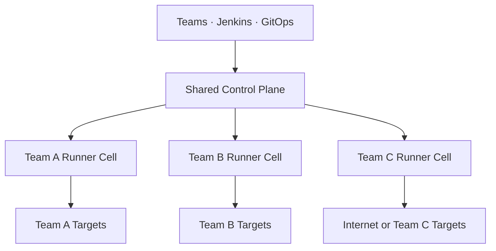
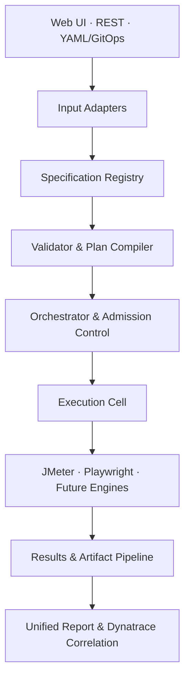
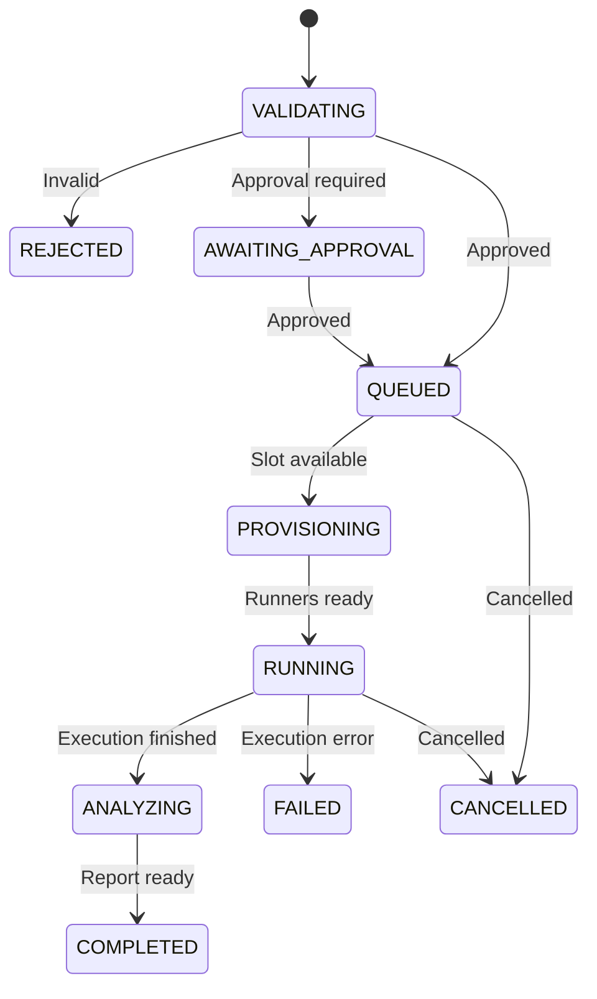
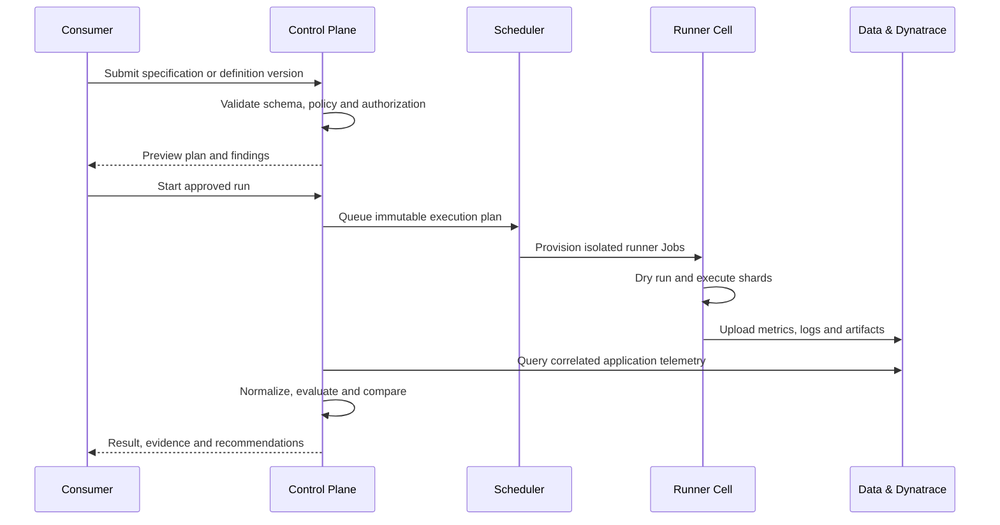

# Ameriprise Self-Service Performance Testing Platform

## Target Architecture and Migration Design

**Status:** Proposed architecture  
**Scope:** Internal Ameriprise platform  
**Baseline repository:** [sanoopbhaskerv/performance-testing-platform](https://github.com/sanoopbhaskerv/performance-testing-platform)  
**Design capacity:** 3–4 simultaneous application-team tests normally; 10 simultaneous tests at peak; up to 1,000 virtual users per team test

---

## 1. Executive decision

The current repository is a good proof of concept and should be evolved rather than discarded. JMeter is not the fundamental scalability problem. The principal issue is that the Spring Boot control plane currently launches JMeter as a local subprocess and retains reports on its local filesystem.

The target platform should separate:

1. **Control plane** — accepts requirements, validates them, schedules tests, enforces policy and tracks state.
2. **Execution plane** — runs JMeter or Playwright workloads in isolated, ephemeral Kubernetes Jobs.
3. **Analysis plane** — normalizes results, evaluates objectives, correlates Dynatrace telemetry and produces reports.

All consumer channels—web UI, REST API and YAML/GitOps—must produce the same versioned, engine-neutral `PerformanceTestSpecification`. Engine-specific scripts are generated only after validation.

For the expected scale, the platform does **not** initially need Kafka, Temporal or a complex distributed workflow product. PostgreSQL-backed durable orchestration plus Kubernetes Jobs provides sufficient scale and is easier for application teams to operate.

---

## 2. Product goals

### Primary goals

- A consumer should describe performance requirements without knowing JMeter internals.
- Support web UI, REST API and YAML/GitOps with identical capabilities.
- Import API definitions from OpenAPI, Postman, HAR, cURL or manual steps.
- Import an approved Playwright test for browser testing in the MVP.
- Run HTTP/API and real-browser workloads independently or together.
- Support load, stress, spike, endurance and baseline-comparison tests.
- Isolate each test run so that one team cannot exhaust the platform.
- Provide real-time status, normalized metrics, SLA evaluation and downloadable evidence.
- Integrate with Dynatrace for application-side diagnosis.
- Allow a centrally managed deployment and a standalone team-owned deployment from the same product.

### Deliberate non-goals for the MVP

- Fully autonomous AI generation and execution of unreviewed test scripts.
- Thousands of simultaneous real-browser sessions.
- Support for every JMeter protocol and plugin.
- Automatic production testing without target allowlisting and approval.
- Direct heap/thread dump collection as a default platform capability.
- A commercial external multi-tenant SaaS model.

---

## 3. Current-state assessment

The existing implementation already contains useful foundations:

- Spring Boot REST API and React web UI.
- Team YAML configuration.
- JMeter templates for load, spike and endurance tests.
- PostgreSQL persistence.
- SLA evaluation and report generation.
- Jenkins integration.
- Helm packaging and Karpenter configuration.
- Prometheus and Grafana starter configuration.

The principal production limitations are:

| Current behavior | Impact | Target correction |
|---|---|---|
| `ProcessBuilder` starts JMeter inside `platform-core` | Control-plane CPU, memory and lifecycle are coupled to load generation | Create an isolated Kubernetes Job for every runner shard |
| Spring `@Async` holds the test lifecycle | Work can be lost or orphaned when the pod restarts | Persist a state machine in PostgreSQL and reconcile it |
| JMX, CSV and HTML reports use local paths | A second replica cannot access the first replica's artifacts | Store immutable artifacts in S3-compatible object storage |
| `replicaCount: 1` | No control-plane high availability | Run at least two stateless API replicas |
| YAML is loaded into local memory | Replicas can have different configuration versions | Store immutable specifications and versions in PostgreSQL/object storage |
| Any valid API key authenticates globally | A key is not restricted to its application team | Bind identities to a team and authorize every resource |
| Report endpoints are public | Test evidence and URLs can be exposed internally | Require authorization and issue time-limited download links |
| API accepts only `team` and `type` | The API is not a complete self-service authoring surface | Accept or reference the canonical specification |
| Endpoint lists are flattened | Scenario weights, extraction, correlation and realistic journeys are lost | Compile typed scenarios into engine-specific plans |
| No queue, quota or admission control | Simultaneous runs can exhaust infrastructure or targets | Add global/team concurrency and workload budgets |
| Static Helm Job template is not reconciled by the Java application | Kubernetes packaging exists but is not the execution system | Add a Kubernetes execution provider and Job watcher |

---

## 4. Recommended deployment model

### 4.1 Shared control plane with team-local execution cells

This is the recommended enterprise target.



The shared control plane owns:

- Web UI and public internal API.
- Identity, team authorization and audit.
- Test-definition registry and version history.
- Specification validation and plan compilation.
- Global admission control.
- Test history, comparisons and report index.

Each team-local runner cell owns:

- Kubernetes namespace and service account.
- JMeter and Playwright runner Jobs.
- Network access to the team's targets.
- Team-specific secret references.
- Optional node pool and Karpenter policies.

The runner cell should use outbound communication to the control plane or object storage wherever possible. It should not require the shared control plane to open inbound access to a team's Kubernetes cluster.

### 4.2 Standalone team deployment

The same Helm distribution should support a standalone profile that installs the UI, API, scheduler, PostgreSQL connection and runners in a team's infrastructure. This is useful when central hosting or cross-network connectivity is not initially approved.

The tradeoff is operational duplication: every team must keep its instance patched and upgraded. A central Helm chart, approved container registry and automated upgrade pipeline are therefore mandatory.

### 4.3 Deployment recommendation

Start the MVP as one deployable product with two Helm profiles:

- `profile=standalone`: complete platform in one team namespace.
- `profile=shared-runner`: execution agent and runners only.

This avoids designing two products and provides a migration path to a shared control plane.

---

## 5. Logical architecture



### 5.1 Experience layer

#### Web UI

Provide a guided wizard rather than exposing engine concepts:

1. Select application and environment.
2. Import or define API/browser journeys.
3. Define traffic and duration.
4. Provide data and authentication references.
5. Define performance objectives.
6. Validate and preview the generated execution plan.
7. Submit or request approval.
8. View live execution and compare results.

#### REST API

The REST API supports the same lifecycle and is used by Jenkins:

- Validate a specification.
- Create/version a test definition.
- start a run with an idempotency key.
- Poll or stream state.
- Cancel a run.
- Download authorized artifacts.
- Compare runs.

#### YAML/GitOps

The YAML format is the serialization of the same domain model used by the UI and API. A pull request can validate the YAML without executing it. A merge or Jenkins step can trigger an approved definition version.

### 5.2 Input adapters

Adapters translate source material into canonical scenarios:

- OpenAPI/Swagger importer.
- Postman Collection importer.
- HAR importer.
- cURL importer.
- Manual endpoint builder.
- Existing Playwright repository/path importer.
- Future visual recorder.
- Future AI-assisted authoring adapter.

An importer produces a draft. It does not automatically grant permission to execute the target.

### 5.3 Specification registry

The registry stores:

- Logical test definition.
- Immutable version.
- Original imported source.
- Normalized scenarios.
- validation findings.
- Reviewer and approval status.
- Owner team and application.

Every run references an immutable definition version, allowing exact reproduction.

### 5.4 Validator and plan compiler

Validation occurs in layers:

1. **Schema validation** — field types, required values and supported versions.
2. **Policy validation** — team quota, target allowlist, duration, environment and approval.
3. **Connectivity preflight** — DNS, TLS and target health from the selected runner cell.
4. **Scenario validation** — authentication, variables, extraction rules, test-data availability and expected responses.
5. **Capacity planning** — worker count, CPU/memory requests and expected browser count.
6. **Compilation** — generate JMX, Playwright harness and runner manifest.
7. **Dry run** — one user/one iteration before material load.

The compiler output is an immutable `ExecutionPlan`. Consumers can see a human-readable preview but do not need to edit JMX.

### 5.5 Durable orchestrator

The orchestrator is a persisted state machine:



The database is the source of truth. A reconciler repeatedly compares desired state, runner state and stored run state. Restarting a control-plane pod must not lose or duplicate a run.

### 5.6 Admission control

Initial platform limits:

| Limit | Proposed default |
|---|---:|
| Normal simultaneous application-team runs | 3–4 |
| Global hard limit | 10 |
| Maximum API virtual users per team run | 1,000 |
| Default concurrent runs per team | 1 |
| Maximum concurrent runs per team | 2 with policy approval |
| Default real-browser sessions | 5 |
| Initial maximum real-browser sessions | 20 |
| Default maximum test duration | 60 minutes |
| Endurance exception | Approval and scheduled window |

Limits are policies, not hard-coded constants.

Admission control evaluates:

- Global execution slots.
- Team quota.
- Expected virtual users.
- Browser resource budget.
- Target/environment window.
- Runner-cell health.
- Available node capacity.
- Approval requirements.

### 5.7 Execution cells

An execution cell consists of:

- A small runner agent or Kubernetes Job submitter.
- Namespace-scoped service account.
- NetworkPolicy and egress controls.
- Engine-specific runner images.
- Optional dedicated Karpenter NodePool.
- Secret provider integration.

Every run creates one or more immutable Jobs. Kubernetes Jobs provide completion tracking and resource isolation; their retry policy must be deliberately restricted because automatically replaying a load test can duplicate traffic. Use `restartPolicy: Never` and normally `backoffLimit: 0`.

### 5.8 Engine providers

The engine integration is an SPI, not a switch statement inside the orchestrator.

```java
public interface ExecutionEngineProvider {
    String engineId();
    EngineCapabilities capabilities();
    ValidationResult validate(PerformanceTestSpecification specification);
    CompiledWorkload compile(ExecutionPlan plan);
    List<RunnerShard> shard(CompiledWorkload workload, CapacityProfile capacity);
    NormalizedRunResult normalize(RunnerArtifacts artifacts);
}
```

Initial providers:

- `jmeter-http`: API/protocol load, stress, spike and endurance.
- `playwright-browser`: approved real-browser journeys and user-experience probes.
- `browserstack-playwright`: optional remote Playwright provider.

Future provider:

- `k6`: only after Ameriprise open-source and architecture approval.

k6 is open source but uses the AGPL-3.0 license, so “open source” alone should not be treated as automatic enterprise approval. The platform should not depend on it for the MVP.

---

## 6. API and browser workload strategy

### 6.1 API/protocol workload

JMeter remains the MVP protocol engine because it is already in the repository and supports the required scale.

Rather than making one JMeter controller manage multiple remote engines through RMI, the platform should prefer independent sharded Jobs:

- The compiler divides the required load across shards.
- Every shard runs the same immutable plan with `shardIndex` and `shardCount`.
- Test-data partitions are non-overlapping.
- Every shard uploads JTL, logs and summary output.
- The result pipeline merges normalized samples and evaluates global objectives.

At the expected 1,000-user maximum, most tests will likely need one to four JMeter shards. The exact number must be determined by calibrating the approved runner image against representative workloads; virtual-user count alone is not a reliable CPU-sizing measure.

### 6.2 Browser workload

Browser execution answers a different question from protocol load.

- JMeter generates large backend load economically.
- Playwright measures real navigation, rendering, JavaScript, network waterfalls and user-visible behavior.

A hybrid run should start protocol load, wait until the desired steady state, and then run a small Playwright cohort while the application is under load.

For the MVP:

- Import an existing Playwright test by repository, ref and path.
- Build it using a pinned approved Node/Playwright image.
- Run a validation pass before accepting it as a test-definition version.
- Require review before the first material execution.
- Retain Playwright HTML report, trace, screenshot, console output and network evidence.
- Limit browsers separately from API virtual users.
- Allow BrowserStack as an optional execution provider, not a platform dependency.

Future authoring may combine:

- Visual recording.
- Plain-English intent.
- AI-generated candidate steps.
- Existing page objects and selectors.
- Mandatory generated-diff review before approval.

AI should assist authoring, not bypass governance or directly execute an unreviewed script.

---

## 7. Canonical specification

The following illustrates a hybrid API and browser test. The exact schema should be published as JSON Schema and versioned.

```yaml
apiVersion: performance.ameriprise.com/v1alpha1
kind: PerformanceTest

metadata:
  name: proposal-workflow-baseline
  team: advice-implementation
  application: proposal
  labels:
    tier: tier-0
    portfolio: awm

spec:
  environment:
    name: performance
    runnerCell: advice-perf-eks
    targetClass: non-production

  sources:
    - name: proposal-api
      type: openapi
      uri: artifact://proposal/openapi.yaml

    - name: proposal-browser
      type: playwright
      git:
        repository: ssh://bitbucket/proposal-e2e.git
        ref: 8f121c7
        path: tests/performance/proposal-journey.spec.ts

  authentication:
    - name: test-user
      type: oauth2-client-credentials
      secretRef: vault://perf/proposal/client

  datasets:
    - name: client-data
      source:
        type: object-storage
        uri: artifact://datasets/proposal-clients.csv
      partitionByShard: true

  workloads:
    - name: api-background-load
      type: protocol
      engine: jmeter
      sourceRef: proposal-api
      model:
        type: stages
        stages:
          - duration: 5m
            targetUsers: 200
          - duration: 20m
            targetUsers: 600
          - duration: 5m
            targetUsers: 0
      scenarios:
        - name: search-client
          weight: 60
          operationId: searchClient
        - name: open-proposal
          weight: 30
          operationId: getProposal
        - name: save-proposal
          weight: 10
          operationId: saveProposal

    - name: browser-experience
      type: browser
      engine: playwright
      sourceRef: proposal-browser
      startWhen:
        workload: api-background-load
        stage: steady-state
      browserUsers: 5
      iterationsPerUser: 3

  objectives:
    - metric: http.response.time
      scope: api-background-load
      percentile: 95
      threshold: 750ms
    - metric: http.error.rate
      scope: api-background-load
      threshold: 1%
    - metric: browser.journey.duration
      scope: browser-experience
      percentile: 95
      threshold: 8s

  observability:
    provider: dynatrace
    correlationHeader: X-Performance-Test-Run-Id
    serviceTagSelector: application:proposal
    collect:
      - service-response-time
      - failure-rate
      - cpu
      - memory
      - database-time

  governance:
    maxDuration: 45m
    approvalPolicy: non-production-standard
    retention: 90d
```

The UI and REST API should create exactly this model. They should not maintain separate request structures.

---

## 8. Run sequence



---

## 9. Data and storage design

### PostgreSQL

Use PostgreSQL for transactional metadata:

- `teams`
- `applications`
- `test_definitions`
- `test_definition_versions`
- `source_imports`
- `execution_plans`
- `test_runs`
- `runner_shards`
- `run_events`
- `metric_summaries`
- `objective_results`
- `approvals`
- `audit_events`

Every tenant-owned row includes `team_id`. Authorization filters must be applied in the service layer and preferably reinforced using PostgreSQL row-level security where supported by Ameriprise standards.

### Object storage

Use an encrypted S3-compatible store for:

- Imported OpenAPI/Postman/HAR artifacts.
- Compiled JMX plans.
- Playwright source bundles.
- JTL/CSV output.
- Playwright traces, screenshots and reports.
- Runner logs.
- Unified reports.

Runners should upload through narrowly scoped IAM roles or time-limited upload URLs. Artifact paths should be immutable and include team, run ID and shard ID.

### Metrics

For the MVP:

- Store normalized summaries and objective outcomes in PostgreSQL.
- Store detailed raw results in object storage.
- Stream live progress events through Server-Sent Events.
- Use Dynatrace for application and infrastructure diagnosis.

This removes the requirement to operate a separate Prometheus/Grafana stack for every team. A Prometheus-compatible export can remain available when useful.

---

## 10. Dynatrace integration and JVM diagnostics

Dynatrace should be the preferred application-observability integration.

For each run:

1. Generate a unique run ID.
2. Inject `X-Performance-Test-Run-Id` into JMeter and Playwright requests.
3. Configure Dynatrace to capture it as a request attribute or equivalent approved correlation field.
4. Record the application, environment, definition version and workload stage.
5. Query Dynatrace for the test window and tagged services.
6. Attach service response time, errors, CPU, memory, database and downstream-call evidence to the unified report.

The current heap/thread dump functionality should be moved out of the core lifecycle.

- Heap dumps are large, invasive, JVM-specific and may contain sensitive data.
- Thread dumps are less intrusive but still require privileged target access.
- Both create a security and retention obligation.

Recommended order:

1. Use Dynatrace telemetry and root-cause analysis by default.
2. Offer thread-dump collection as an approved diagnostic plugin.
3. Offer heap-dump collection only for explicitly approved non-production targets, using a dedicated service identity and encrypted short-retention storage.

The execution platform should never store JMX credentials or diagnostic endpoints directly in YAML.

---

## 11. Enterprise integration explained

“Enterprise integration” means that the platform participates in Ameriprise identity, delivery and control systems instead of maintaining independent credentials and governance.

### Human identity

Use corporate OIDC/OAuth2 SSO. The platform maps identity-provider groups or claims to teams and roles.

Recommended roles:

| Role | Capability |
|---|---|
| Platform Administrator | Manage policies, engines, runner cells and global capacity |
| Team Administrator | Manage team applications, members and secret references |
| Test Author | Create and version test definitions |
| Test Approver | Approve restricted targets, durations or production runs |
| Test Runner | Trigger previously approved definitions |
| Viewer | View team runs and authorized reports |

### CI identity

Jenkins must not reuse a person's API key. Use a service identity or OAuth2 client credential bound to:

- One team.
- Selected applications.
- `validate`, `execute` or `read` scopes.
- An expiration and rotation policy.

### Secrets

Specifications contain only `secretRef` values. Runtime secrets are resolved from the approved enterprise secret manager or Kubernetes External Secrets integration and are mounted only into the runner Job.

### Guardrails

- Target hostname/CIDR allowlist.
- Environment classification.
- Maximum users and duration.
- Team and global concurrency.
- Production-change/approval window.
- Outbound network restrictions.
- Request-rate emergency stop.
- Audit record for definition, approver, runner identity and artifacts.
- Data-retention and deletion policy.

### Delivery integration

- Jenkins shared-library step for validate, start, wait and publish.
- Bitbucket/GitHub status checks for definition validation.
- Webhook or Slack/email notification using approved enterprise channels.
- Container images from an approved internal registry.
- Helm chart and policy bundle released centrally.

---

## 12. Security model

### Required controls

- Corporate SSO for users.
- Scoped CI service identities.
- Team-level resource authorization.
- No secrets in YAML, database columns, generated JMX or logs.
- Encrypted PostgreSQL and object storage.
- TLS for every service boundary.
- Namespace-isolated runner service accounts.
- Read-only root filesystem where possible.
- NetworkPolicies and explicit egress.
- Signed and scanned runner images.
- Test target allowlisting.
- Authorization on reports and artifacts.
- Audit trail for all material actions.
- Automatic masking of authorization headers, cookies and configured sensitive fields.

### Abuse and accident prevention

A load-testing platform can resemble a denial-of-service system. Therefore:

- Reject unapproved internet domains.
- Resolve and revalidate DNS before execution to reduce DNS-rebinding risk.
- Block link-local, metadata and prohibited network ranges unless explicitly allowed.
- Apply server-side user/rate ceilings independent of the submitted JMX.
- Sign compiled execution plans.
- Do not allow arbitrary shell commands or unrestricted JMeter plugins.
- Run imported Playwright code in a restricted runner image and namespace.
- Provide immediate global and per-run kill switches.

---

## 13. Scalability and availability

### Capacity model

| Dimension | Design target |
|---|---:|
| Normal simultaneous team tests | 3–4 |
| Peak simultaneous team tests | 10 |
| Maximum users per team test | 1,000 |
| Theoretical aggregate protocol users | 10,000 |
| Expected JMeter shards per run | 1–4 after calibration |
| Control-plane replicas | 2 minimum |
| Scheduler active instances | 1 logical leader with standby |

### Scaling approach

- Scale the control plane horizontally; it does not generate load.
- Scale runner shards by compiled capacity profile.
- Use dedicated tainted nodes for heavy load generators.
- Allow Karpenter to provision nodes based on Job resource requests.
- Use topology spread so shards do not all share one node.
- Add per-cell quotas so one team cannot consume the cluster.
- Pre-warm capacity for scheduled critical runs when node-start latency would affect the test.

### Reliability rules

- `POST /test-runs` requires an idempotency key.
- A run references one immutable plan digest.
- Job submission records the Kubernetes Job UID before moving to `RUNNING`.
- Runner heartbeats detect stalled workloads.
- Control-plane restart resumes reconciliation.
- A missing runner does not silently retry material traffic.
- Cancellation stops runner Jobs and marks incomplete artifacts.
- Partial shard completion is reported as incomplete, not merged as a valid pass.
- Objective evaluation is deterministic and repeatable from stored artifacts.

---

## 14. API surface

### Definitions

```text
POST   /api/v1/test-definitions/validate
POST   /api/v1/test-definitions
GET    /api/v1/test-definitions/{definitionId}
POST   /api/v1/test-definitions/{definitionId}/versions
POST   /api/v1/test-definitions/{definitionId}/versions/{version}/approve
```

### Imports

```text
POST   /api/v1/imports/openapi
POST   /api/v1/imports/postman
POST   /api/v1/imports/har
POST   /api/v1/imports/curl
POST   /api/v1/imports/playwright
GET    /api/v1/imports/{importId}/findings
```

### Runs

```text
POST   /api/v1/test-runs
GET    /api/v1/test-runs/{runId}
GET    /api/v1/test-runs/{runId}/events
POST   /api/v1/test-runs/{runId}/cancel
GET    /api/v1/test-runs/{runId}/report
GET    /api/v1/test-runs/{runId}/artifacts
POST   /api/v1/test-runs/compare
```

### Platform

```text
GET    /api/v1/runner-cells
GET    /api/v1/capacity
GET    /api/v1/policies
GET    /api/v1/engines
```

Use RFC 7807 problem responses, correlation IDs, pagination and OpenAPI documentation. Trigger endpoints return `202 Accepted`.

---

## 15. Recommended codebase structure

Retain Java/Spring Boot for the control plane and React for the UI, but split the monolith into clean modules before splitting deployables unnecessarily.

```text
performance-testing-platform/
├── platform-domain/             # Engine-neutral domain and state machine
├── platform-api/                # REST, auth and DTO mapping
├── platform-orchestration/      # Admission, scheduler and reconciliation
├── platform-persistence/        # PostgreSQL repositories and migrations
├── platform-importers/
│   ├── importer-openapi/
│   ├── importer-postman/
│   ├── importer-har/
│   └── importer-playwright/
├── platform-engine-spi/
├── engines/
│   ├── engine-jmeter/
│   ├── engine-playwright/
│   └── engine-browserstack/
├── runner-images/
│   ├── jmeter-runner/
│   └── playwright-runner/
├── platform-results/            # Normalization, SLA and comparisons
├── platform-observability/
│   └── dynatrace-provider/
├── platform-ui/
├── helm/
│   ├── performance-control-plane/
│   └── performance-runner-cell/
└── docs/
    ├── architecture/
    ├── specifications/
    └── operations/
```

Keep these as Maven modules within a modular monolith initially. Deploy only:

- `platform-control-plane`
- `runner-agent` when using team-local cells
- ephemeral engine Jobs

This provides strong separation without creating an unnecessary microservice estate.

---

## 16. Migration roadmap

### Phase 0 — Correct and harden the current proof of concept

- Replace API keys embedded in team YAML.
- Protect report endpoints.
- Add Flyway migrations instead of `ddl-auto:update`.
- Add request validation and structured errors.
- Add idempotency and cancellation.
- Pin all container and dependency versions.
- Calibrate one JMeter pod for representative API workloads.

### Phase 1 — Establish the scalable foundation

- Introduce canonical specification and immutable versions.
- Separate domain, API, orchestration, engine SPI and result modules.
- Move run state to a durable PostgreSQL state machine.
- Submit a Kubernetes Job instead of launching a local process.
- Move artifacts to encrypted object storage.
- Add global/team admission control.
- Run two stateless control-plane replicas.

**Exit criterion:** The control plane can restart during a test without losing it, and ten isolated team runs can be queued/executed according to policy.

### Phase 2 — Complete API self-service

- OpenAPI, Postman, HAR, cURL and manual importers.
- Scenario weighting, correlation, extraction and test-data partitioning.
- Dry-run validation and execution-plan preview.
- Jenkins shared-library integration.
- Baseline comparison and unified reporting.

**Exit criterion:** A consumer can onboard an API without writing JMX.

### Phase 3 — Add approved browser journeys

- Playwright repository/ref/path importer.
- Pinned, restricted Playwright runner.
- Hybrid protocol-load and browser-probe coordination.
- Traces, screenshots, browser metrics and HTML reports.
- Optional BrowserStack provider.

**Exit criterion:** A team can import and review a Playwright journey, then measure it while API load is active.

### Phase 4 — Enterprise observability and federation

- Dynatrace request correlation and metric enrichment.
- Shared control-plane/team-runner deployment profile.
- OIDC, team RBAC and CI service identities.
- Team-local runner health and capacity reporting.
- Central chart/image/policy release process.

### Phase 5 — Assisted authoring

- Visual recorder.
- AI-assisted generation from intent, OpenAPI and page models.
- Generated-script diff and review.
- Recommendation engine using baseline history and Dynatrace evidence.

AI-generated tests remain drafts until validated and approved.

---

## 17. Architecture decisions

| Decision | Choice | Reason |
|---|---|---|
| Control vs execution | Separate planes | Prevent load generation from destabilizing the API |
| MVP protocol engine | JMeter | Already implemented and likely easier to approve |
| MVP browser engine | Playwright | Approved and supports imported real-browser tests |
| k6 | Deferred plugin | Technically suitable, but AGPL and enterprise approval require review |
| Workflow infrastructure | PostgreSQL state machine + reconciler | Sufficient for 10 concurrent team runs and materially simpler |
| Runner runtime | Kubernetes Jobs | Isolation, resource limits, completion semantics and autoscaling |
| Result storage | PostgreSQL summaries + object storage artifacts | Durable, scalable and replica-safe |
| Application telemetry | Dynatrace provider | Aligns with the existing Ameriprise tool |
| Deployment | Shared control plane plus team cells; standalone profile supported | Central governance with network-local execution |
| AI | Authoring assistant, not autonomous executor | Keeps the MVP safe and deterministic |

---

## 18. Decisions still needed

These do not block the architecture but must be resolved before implementation:

1. Corporate identity provider and how team/group claims are exposed.
2. Whether the first release is standalone per team or a shared control plane.
3. Approved enterprise secret manager.
4. Object-storage service and retention period.
5. Rules for performance testing production and external targets.
6. Whether runner cells can make outbound calls to a central control plane.
7. BrowserStack license and acceptable concurrency.
8. Dynatrace API access, request-attribute configuration and retention.

Recommended MVP defaults:

- Standalone deployment first, while preserving the shared-runner protocol.
- Non-production targets only.
- JMeter and local Playwright only.
- PostgreSQL plus S3-compatible storage.
- OIDC-enabled architecture with a temporary development identity adapter.
- Dynatrace correlation integration, without automatic heap dumps.

---

## 19. Reference rationale

- Apache JMeter supports distributed testing, and its own best-practice guidance also recognizes multiple autonomous CLI instances whose result files are combined. The platform uses autonomous Kubernetes shards to avoid remote-controller coupling: [JMeter distributed testing](https://jmeter.apache.org/usermanual/remote-test.html) and [JMeter best practices](https://jmeter.apache.org/usermanual/best-practices.html).
- Kubernetes Jobs provide bounded completion and retry semantics suitable for ephemeral runners. Performance tests should override retries to prevent accidental duplicate traffic: [Kubernetes Jobs](https://kubernetes.io/docs/concepts/workloads/controllers/job/).
- Karpenter can provision right-sized compute in response to unschedulable workloads: [Amazon EKS Karpenter guidance](https://docs.aws.amazon.com/eks/latest/best-practices/karpenter.html).
- Playwright supports CI execution, traces and post-run inspection: [Playwright CI](https://playwright.dev/docs/ci) and [Trace Viewer](https://playwright.dev/docs/trace-viewer).
- Dynatrace APIs can automate monitoring and export telemetry for report enrichment: [Dynatrace API](https://docs.dynatrace.com/docs/dynatrace-api).
- k6 is open source but distributed under AGPL-3.0, which requires Ameriprise review before adoption: [Grafana k6 repository and license](https://github.com/grafana/k6).
- Time-limited object-storage upload/download access can avoid distributing storage credentials to runners: [Amazon S3 presigned uploads](https://docs.aws.amazon.com/AmazonS3/latest/userguide/PresignedUrlUploadObject.html).

