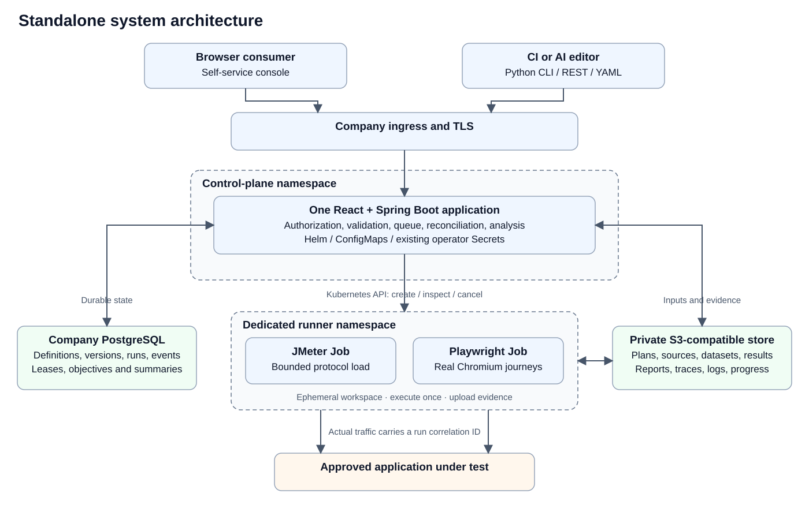
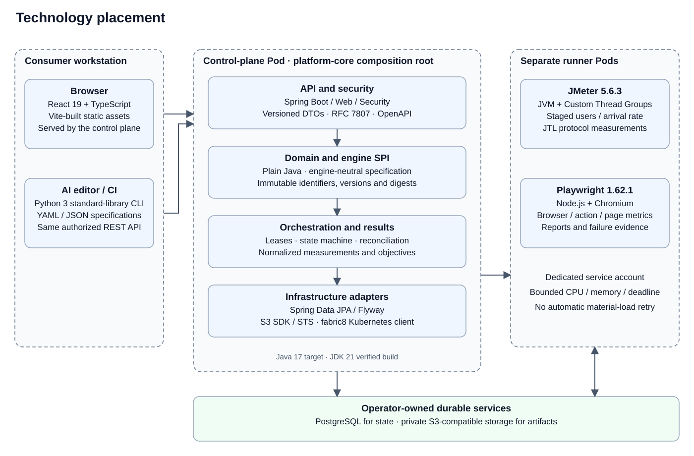
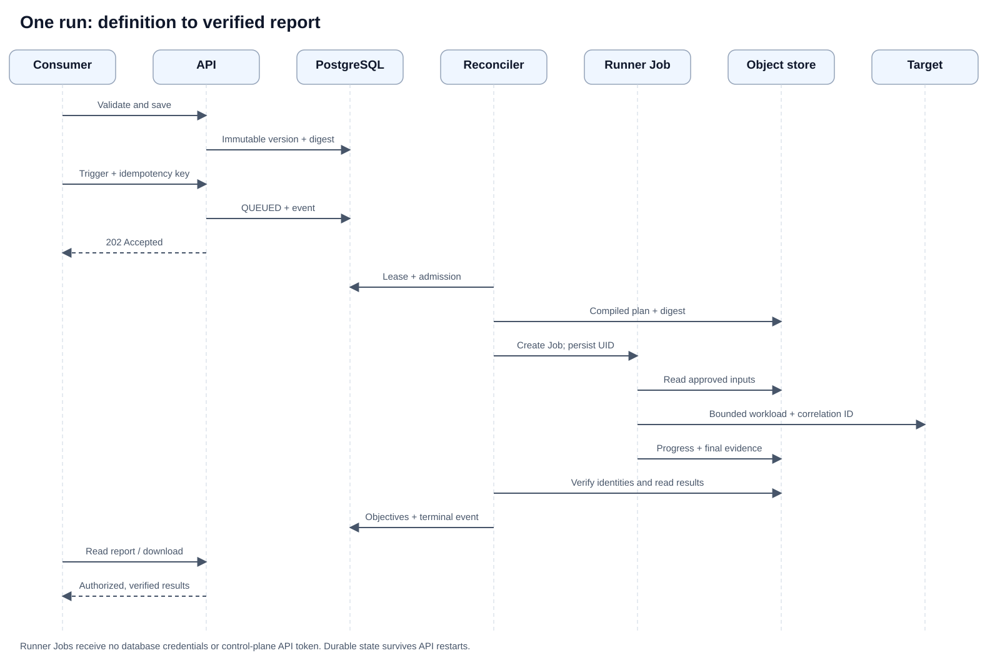

# Architecture and technology placement

This describes the implemented standalone V2 product. The longer target architecture includes
future enterprise capabilities; it is not a declaration that those capabilities are shipped.

The SVG diagrams below work offline and without a rich-preview service. Regenerate them using
`python3 scripts/render-architecture-diagrams.py`; keep the editable Mermaid source and labels in sync.

## System architecture



<details>
<summary>Editable Mermaid source</summary>

```text
flowchart LR
  User["Consumer in a browser"]
  CLI["CI or AI editor<br/>Python CLI / REST / YAML"]
  subgraph Control["Company Kubernetes cluster · control-plane namespace"]
    Ingress["Company ingress · TLS"]
    App["One control-plane application<br/>React UI + Spring Boot API<br/>authorization · validation · queue · reconciliation · analysis"]
    Config["Helm / ConfigMaps<br/>branding · application settings"]
    Secrets["Existing operator Secrets<br/>identity hashes · DB credentials"]
    Ingress --> App
    Config --> App
    Secrets --> App
  end
  subgraph Runners["Dedicated runner namespace"]
    JMeter["Ephemeral JMeter Job<br/>protocol traffic"]
    Browser["Ephemeral Playwright Job<br/>real Chromium journeys"]
  end
  PG[("Company PostgreSQL<br/>definitions · versions · runs · events · summaries")]
  S3[("Private S3-compatible storage<br/>plans · scripts · datasets · results · reports · traces")]
  Target["Approved application under test"]
  User --> Ingress
  CLI --> Ingress
  App --> PG
  App --> S3
  App -->|"Kubernetes API: create / inspect / cancel"| JMeter
  App -->|"Kubernetes API: create / inspect / cancel"| Browser
  JMeter -->|"read plan · upload evidence / progress"| S3
  Browser -->|"read plan / reviewed source · upload evidence / progress"| S3
  JMeter -->|"bounded API load · run correlation header"| Target
  Browser -->|"bounded browser cohort · run correlation header"| Target
```

</details>

The control plane is a modular monolith. Its HTTP validator may send one iteration before a run;
material performance load runs in Jobs. PostgreSQL is the authority for execution state. Runner
workspaces are temporary. Every run points to an immutable definition version and compiled-plan
digest. Jobs execute once with no automatic material-load retry. A reconciler observes durable
state and Kubernetes handles after a restart.

## Technology placement



<details>
<summary>Editable Mermaid source</summary>

```text
flowchart TB
  subgraph Client["Consumer workstation"]
    Web["Chrome / Edge<br/>React 19 · TypeScript · Vite-built static assets"]
    Tools["Any AI editor / Jenkins / GitHub Actions<br/>Python 3 standard-library CLI · YAML / JSON"]
  end
  subgraph API["Control-plane Pod · platform-core composition root"]
    HTTP["Spring Boot · Spring Web / Security<br/>V2 DTOs · RFC 7807 · OpenAPI"]
    Domain["platform-domain + engine SPI<br/>plain Java · engine-neutral specification"]
    Loop["Orchestration + results<br/>leases · state machine · objective evaluation"]
    Adapters["Spring Data JPA / Flyway<br/>S3 SDK · fabric8 Kubernetes client"]
    HTTP --> Domain
    HTTP --> Loop
    Loop --> Adapters
  end
  subgraph Execution["Runner Pods · separate service account / resources"]
    JM["JMeter 5.6.3 + Custom Thread Groups<br/>JVM · protocol samples / JTL"]
    PW["Playwright 1.62.1 + Chromium<br/>Node.js · journey / page / action measurements"]
  end
  Data["Managed or operator-owned PostgreSQL + S3-compatible object storage"]
  Web --> HTTP
  Tools --> HTTP
  Adapters --> Data
  Adapters --> Execution
```

</details>

Java source targets Java 17; the verified build toolchain uses JDK 21. Build the complete console/API
image from `docker/Dockerfile.control-plane`. Each runner has a separate Dockerfile and version.
Kubernetes, PostgreSQL, storage, registry, TLS, DNS and network enforcement belong to the operator.
No external AI service is required to run the platform or its portable editor skill.

## One run, end to end



<details>
<summary>Editable Mermaid source</summary>

```text
sequenceDiagram
  actor Consumer
  participant API as UI / REST API
  participant DB as PostgreSQL
  participant Scheduler as Reconciler
  participant Job as Kubernetes runner Job
  participant Store as Object storage
  participant Target as Approved target
  Consumer->>API: Validate and save specification
  API->>DB: Immutable version + specification digest
  Consumer->>API: Trigger version + idempotency key
  API->>DB: QUEUED run + event
  API-->>Consumer: 202 Accepted + run location
  Scheduler->>DB: Lease eligible run, apply admission policy
  Scheduler->>Store: Compiled plan + digest
  Scheduler->>Job: Provision once, persist Job UID
  Job->>Store: Read plan / sources
  Job->>Target: Execute bounded workload with correlation ID
  Job->>Store: Progress + final identity-bound evidence
  Scheduler->>Job: Observe terminal status
  Scheduler->>Store: Verify identities and read results
  Scheduler->>DB: Objectives, artifacts, summary, terminal event
  Consumer->>API: Read report / authorized artifact download
  API-->>Consumer: Measured results and verified evidence
```

</details>

## Deployment boundaries and present limits

Use one standalone installation in a company/team's reachable infrastructure. The target may be in
another network only when DNS, routing, authorization and policy explicitly permit it. The control
plane currently submits to its configured Kubernetes cluster. An outbound remote-cell agent and
cross-cluster federation are future work, not a `values.yaml` switch.

The shipped storage implementation speaks the S3 API. PostgreSQL can be hosted on AWS, Azure,
Google Cloud or on premises. Native Azure Blob Storage and Google Cloud Storage APIs need another
`ArtifactStore`/source/dataset adapter, or an approved compatible S3 service. BrowserStack and human
OIDC also need their provider integrations. See the [extension guide](../development/extending.md).

Runner egress declarations require an enforcing CNI. Runners in a cell share the configured storage
identity; do not assume that this alone isolates mutually untrusted tenants. Use separate
installations and storage identities for those trust boundaries. Five admitted runs are an initial
queue limit, not a measured five-team infrastructure capacity guarantee.
