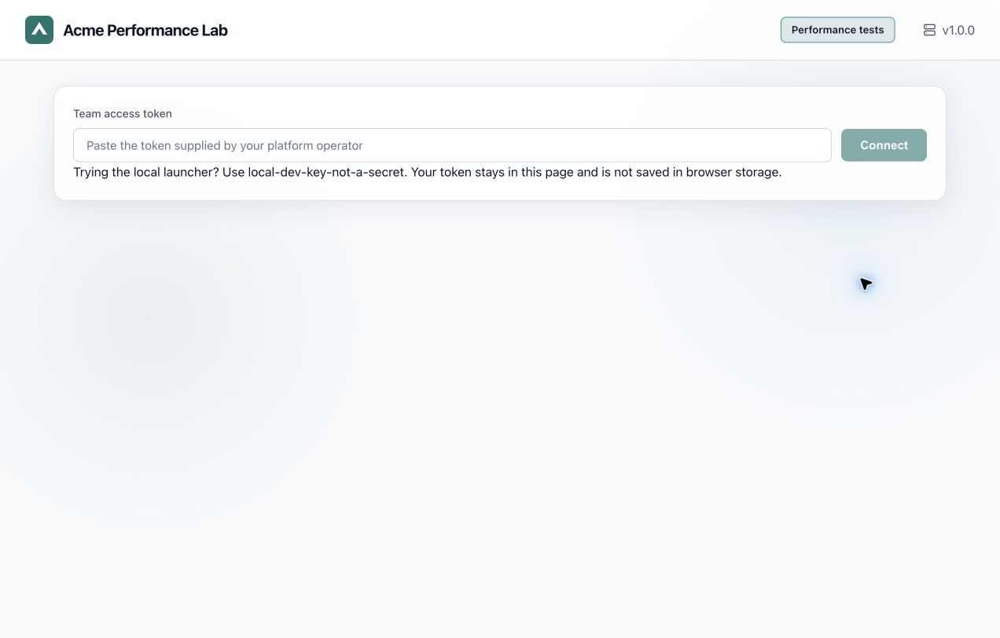

# Set your company name, logo and theme

Branding is runtime configuration. It requires no React changes or UI rebuild. Start from
[`examples/branding/platform-config.json`](../../examples/branding/platform-config.json) or the
`branding` block in [company-values.yaml](../../helm/performance-platform/examples/company-values.yaml).



The same image retains the default Performance Studio/dark configuration internally; this
Acme/light example is supplied by mounted configuration and a logo ConfigMap.

## 1. Choose the public brand settings

```json
{
  "name": "Acme Performance Lab",
  "logoUrl": "/branding/logo.svg",
  "logoAlt": "Acme",
  "theme": "light",
  "colors": { "primary": "#0f766e", "accent": "#0891b2" }
}
```

`name` changes the application header and browser-tab title. `logoAlt` describes the logo for assistive
technology. `theme` is `light` or `dark`; it applies to the shell and studio together. Colors are
six-digit hexadecimal values. The primary color controls actions and selected surfaces; the accent
controls the series/highlight color. Solid action buttons select a contrasting black/white text
color. Status colors remain independent so a company rebrand preserves the meaning of pass/fail.
Review your chosen palette on forms, reports, focus outlines and disabled controls in both themes.

The UI accepts `/branding/...` paths or HTTPS logo URLs without embedded credentials. A company CDN
logo must be reachable by consumers' browsers. Use local assets for offline or private-network
installations. Invalid colors fall back individually; an absent/broken logo falls back to the built-in
icon. A missing configuration file leaves a usable default product.

**This file and logos are public assets. Put no tokens, private endpoints or credentials in them.**

## 2. Apply it locally

Edit `platform-ui/public/platform-config.json`. Copy your logo into
`platform-ui/public/branding/logo.svg` (create the directory) and reload the local Vite console.
The repository includes a small [example logo](../../examples/branding/logo.svg) to verify wiring.
Replace it with your own approved asset before distribution.

## 3. Apply it to a Kubernetes installation

Create a ConfigMap containing your logo in the **control-plane namespace**:

```bash
kubectl -n perf-platform create configmap company-logo --from-file=logo.svg=/private/company/logo.svg
```

Set your private values file:

```yaml
branding:
  name: Acme Performance Lab
  logoUrl: /branding/logo.svg
  logoAlt: Acme
  logoConfigMap: company-logo
  theme: light
  colors:
    primary: "#0f766e"
    accent: "#0891b2"
```

The chart generates `platform-config.json`, mounts it at `/app/ui/platform-config.json`, and mounts
the logo ConfigMap at `/app/ui/branding`. A PNG works the same way: create a `logo.png` key and use
`/branding/logo.png`. Changing branding values changes the Pod-template checksum and rolls the
control plane. Reload the browser afterwards. Replacing only an external logo ConfigMap requires
your normal rollout/cache-refresh procedure; its contents are not hashed by Helm.

## 4. Apply it to a directly run container

Use the combined control-plane image and mount your files read-only:

```bash
# Add these mounts to your normal, fully configured container invocation:
--mount type=bind,src=/private/company/platform-config.json,dst=/app/ui/platform-config.json,readonly
--mount type=bind,src=/private/company/branding,dst=/app/ui/branding,readonly
```

These are mount arguments, not a complete platform startup command. Production still requires
PostgreSQL, object storage, identities and access to the Kubernetes execution provider. If you serve
the frontend through your own web server, serve the JSON at `/platform-config.json` on the same
origin and serve `/branding/...` there too. Preserve the `/api` proxy and access controls.

## 5. Verify and extend

Open the login screen without a team token: confirm the company name, tab title, logo and theme.
Then sign in, open a wizard, and read an actual report. This checks the shell and the studio use the
same brand. `platform-config.json` is fetched without authorization credentials; missing branding
must never prevent test execution or report access.

For deeper visual changes use the semantic tokens in `platform-ui/src/v2/tokens.css`. Components
reference those tokens; `tokens.test.ts` guards against hardcoded colors in studio stylesheets.
The JSON surface deliberately permits no arbitrary HTML, CSS or executable script. Structural
layout changes belong in a reviewed UI change with responsive/accessibility verification.
