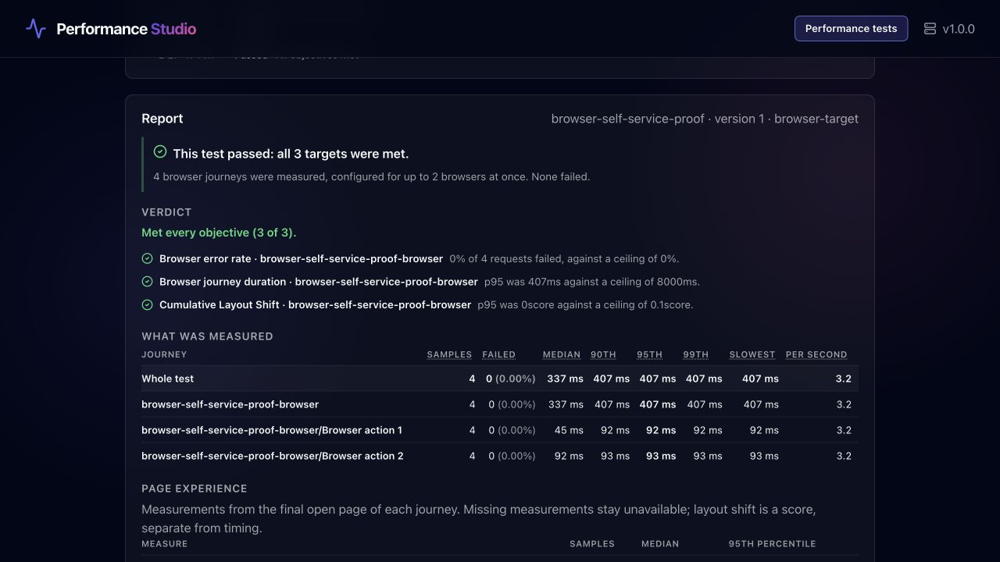
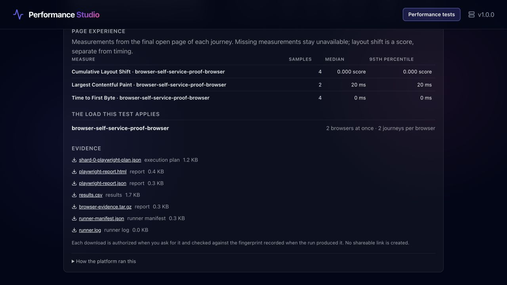

# Browser self-service review — 19 October 2026

Reviewed the existing implementation by walking the production-profile UI and executing its actual
Kubernetes runner, rather than inferring completion from component tests. The initial screen and
About-step captures were saved before fixes; the same flow was walked afterward.

## Journey and changes

| Step | Finding | Result |
|---|---|---|
| Connect and choose a test | Typing a credential triggered requests; production exposed legacy and unavailable recording flows; internal branding dominated the entry point | Explicit Connect action, compact identity summary, available flows only, Performance Studio name |
| 1. About and target | A brand-new application's target registration failed because the application had not been provisioned; the team was not preselected | Authorized registration onboards the application; a single team is selected automatically; successful registration is visible |
| 2. Browser journey | No complete browser authoring path or immutable upload was available | Upload/paste a reviewed script, try a page-opening example, or select an allowlisted immutable repository; codegen guidance explains how to obtain a script |
| 3. Browsers | API user/load concepts could be mistaken for browser capacity | Browser count, repetitions, screen emulation and stop limit with explicit total journey arithmetic and no retries |
| 4. Objectives | API metrics appeared in the browser path; layout-shift units could be interpreted as latency | Browser journey duration/error objectives, optional LCP/TTFB/CLS, score-specific defaults and units |
| 5. Check configuration | Validation could be mistaken for a live browser check | Clearly states what is checked, and that a real run is needed to measure the target |
| 6. Save and run | Incomplete configuration could reach save; runtime authentication looked mandatory | Server-validated save, immutable definition, explicit Run this action, optional session controls collapsed |
| Read results and evidence | Headline statistics included page scores and nested actions; browser reports described request counts and a zero-second API profile | Primary journey aggregation, separate page metrics, browser-specific narrative/cohort, private digest-verified downloads |

The controls expose accessible names, numbered steps, keyboard-accessible native inputs and clear
validation/status text. The script editor now uses the existing dark form styling. The checks here
are a functional and visual accessibility review, not a formal screen-reader or WCAG certification.

## Execution evidence

The six-step wizard authored `browser-self-service-proof`, registered the bundled target, stored a
reviewed two-page journey, selected two browsers and two iterations, added three objectives, checked
and saved the definition, then triggered material execution. The final UI run was
`36bf6494-bd51-40ad-b447-f9a30f2a9b13`: **four primary journeys, synthetic=false, complete evidence,
three PASS objectives**. Journey p95 was 407 ms against an 8-second ceiling on this tiny local
fixture. These timings are verification evidence, not an application benchmark or capacity claim.

The production profile used the shipped Helm chart, PostgreSQL, private MinIO storage and a pinned
non-root Playwright Job with read-only root filesystem, explicit resources and `backoffLimit: 0`.
Restarting the API while the run was ANALYZING completed the same persisted run; Job UID
`c37b5dd0-6c75-4d1f-8d25-ea07cc73ec3c` remained unchanged.

The portable CLI/API check additionally verified:

- A two-journey success with seven authorized artifact downloads, each checked against SHA-256.
- Repeated trigger keys returning the same run.
- A deliberately failing assertion producing a breached browser-error objective and failure evidence.
- Idempotent cancellation waiting for the running Job to disappear.
- Unauthenticated reports denied; separate live checks denied another team's token and expired tokens.

`mvn -B verify`: 1,366 tests, zero failures/errors, one opt-in live-recorder test skipped.
UI: 193 tests, production build and lint pass. Runner: six checks pass, including real Chromium,
digest refusal before traffic, empty/all-skipped tests, failure evidence and snapshot identity.
Both container images built; Helm lint and refusal of unrestricted egress passed. A clean export
of the staged repository also packages successfully, including the formerly ignored Java target packages.

## Reproduction and remaining work

Follow [the deployment guide](../deployment/standalone.md#reproduce-the-disposable-local-browser-proof)
and run `scripts/check-browser-self-service.py`. Fresh namespaces are required for bootstrap;
credentials and raw local proof captures stay under ignored `.local/browser-proof/`.
The original captured walkthrough on the review machine is in
`/Users/sanoopbhaskerv/workspace/performance-testing-platform/.local/browser-proof/screenshots/`.

A novice can configure and run the flow with a reviewed journey; obtaining that journey still
requires an existing Playwright test or external codegen and review. Human SSO, private-git
credentials, named repository project configurations, remote runner federation and BrowserStack
remain extensions. Hybrid authoring remains YAML/API based. INP/TBT/Lighthouse are not collected.
The default limit of five concurrent material runs is an admission setting, not a calibrated
five-team capacity guarantee. Local kind does not verify cloud IAM, storage encryption or CNI
NetworkPolicy enforcement; operators must verify those in their own environment.
